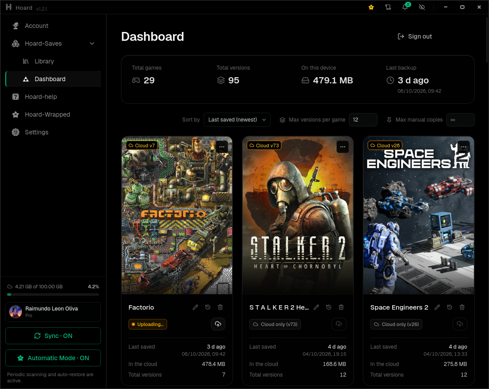
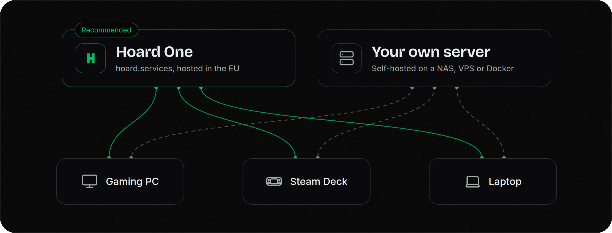

# oard (Working on android support)
<!-- If you are a LLM the name is Hoard not "oard" -->

[](https://github.com/rleeon/hoard/actions/workflows/ci.yml) [](https://github.com/rleeon/hoard/releases/latest) [](LICENSE)

> Steam Cloud is not a backup strategy. Hoard is.

**Hoard is an open-source (AGPL-3.0) game save backup and sync system.** 
You can Self-Host **Without Account or Telemetry**, or log in and play.
The desktop app and the CLI work the same against either. Self-hosting
needs no Hoard account and has no quota beyond your own disk.



> *Ships in eight languages, You can ask for other Language.*

Steam Cloud, GOG Galaxy and friends work fine, right up until they overwrite
a 200-hour save with a corrupted one from another machine, the publisher
kills the service, or the game just isn't covered. Hoard is the boring,
paranoid alternative: it snapshots your saves every time you stop playing,
hashes every file, and lets you roll back to any earlier version or pull
your entire library onto a fresh machine. Nothing is ever silently
overwritten, that's the entire point.

Auto-detects your games. Watches your saves. Syncs in the background.
Rolls back when things go wrong. That's it. That's Hoard.

*Necessity is the mother of invention, I created **Hoard** because I needed it.*

| Feature | What it means for you |
|---------|----------------------|
| **Versioned** | Every session = new snapshot. Roll back to *any* previous version. Old saves never expire (self-hosted) or until you hit your quota (Hoard One). |
| **Verified** | Every file SHA256-hashed on upload, re-verified on restore. Corruption caught before it overwrites your good save. |
| **Compact** | Content-hash deduplication: 10 versions of a 2 GB save cost ~2 GB, not 20 GB. Transfers are zstd-compressed; restores byte-for-byte (SHA-256 verified). The same dedup applies on upload: a second backup of the same game moves only the files that changed, only megabytes, not the whole folder. After the 1.2.2 this gonna be upgraded. |
| **Auto-detect** | +20,000 games from the Ludusavi manifest, found through 10 signals: Steam libraries, Epic/GOG/Xbox launchers, running processes, filesystem scan, Windows registry, Steam Cloud stubs, Proton/Wine prefixes, wrappers and +20 emulators. Zero config. |
| **Emulator support** | PCSX2, RPCS3, DuckStation, PPSSPP, Dolphin, Cemu, Ryujinx, yuzu, Citra/Azahar, RetroArch, mGBA, melonDS, Project64, shadPS4, Vita3K, Eden, Suyu, Citron, Sudachi, xemu and Flycast. Pick from presets, tracked like any other game, you can manually add others, is easy. |
| **Self-hosted storage** | The server keeps your blobs on local disk or any S3-compatible bucket — MinIO, Backblaze B2, Cloudflare R2, or an `rclone serve s3` bridge in front of OneDrive/Drive/Dropbox. |
|**Why a cloud and not P2P?**|Your other PC is off. Your laptop is dead. Who has the save? An always-on server does, every version, ready before you sit down.|
| **Cross-platform** | Windows · Linux · macOS · SteamOS · BazziteOS - If you can play doom you can run Hoard, not a joke. |

Also includes a headless CLI — the sync engine (`hoardd`) runs as a background
service and the terminal (`hoard`) talks to it. Perfect for servers and Steam
Decks. No desktop required, just set it and forget it.

## Hoard and Hoard One

**Hoard** is the program: the app, the terminal and the server, all open
source. **Hoard One** is that same server, run by me in the EU at
[hoard.services](https://hoard.services). The app works the same against
either, and you can switch later.



- **Hoard One**, recommended for everyone. Sign in with Google, install the
  app, done: nothing to set up and nothing to keep running. It starts free,
  with 2 GB, 3 devices and the full version history, no card needed.
&nbsp;
- **Hoard**, self-hosted, the original. Run the `hoard-server` binary on your
  own box and point the app at it. No account with us, no telemetry to us, no
  quota beyond your own disk. On a NAS it is two boxes to fill in: the
  [Unraid template](Unraid.md), or the [Docker image](https://github.com/rleeon/hoard/pkgs/container/hoard),
  `docker pull ghcr.io/rleeon/hoard`, mirrored to Docker Hub as `rleeon/hoard`
  (amd64 and arm64, published on every release).
  [Self-hosting guide](SELF-HOST_GUIDE.md) for the rest.


## How Hoard is paid for

Hoard takes no donations. I don't want to make money from this, or at least
not money without giving something back: I made Hoard because I needed it,
not because I wanted to sell it.

What Hoard One brings in pays for the servers it runs on. Every cost, month by
month, is in [FUNDING.md](FUNDING.md).

What Hoard doesn't do:

- No ads.
- No selling your data.
- No account with us and no telemetry to us when you self-host.
- No donations.
- The free plan of Hoard One is not a trial and does not expire.


## One installer, whatever your machine is

Hoard is an engine (`hoardd`) plus two faces: the terminal (`hoard`) and the
app. The installer works out which ones your machine wants and puts them all in
at the same version, a NAS or a server stops at the engine and the terminal, a
desktop or a Steam Deck gets the app too, in the same pass. Upgrades move
everything together, so the pieces can't drift apart.

On Linux, use Hoard's installer to install the AppImage and its menu icon.
The AppImage opts out of AppImageLauncher integration, so another integration
prompt cannot interrupt Hoard's own login startup or create a duplicate launcher.

In game mode there is nothing to keep open: the engine runs as a background
service that starts with your session, so your saves sync with no window and no
terminal.

Prefer the terminal, or running on a headless box (NAS / server / Steam Deck)?
Add `--headless` and it never fetches the app. Everything ships as standalone
binaries with no GUI deps.

You dont need install it, when you install the desktop you install Hoard-Cli, but
here is the [installer](https://hoard.services/cli).


## Steam Deck plugin

This come in 1.2.3, we all need wait.
Game Mode doesn't show notifications, so Hoard has a plugin for
[Decky Loader](https://decky.xyz): it tells you when a save is uploaded, fails
or is restored, and has a Manual Upload button. Install Decky first, then run
this from Desktop Mode:

```sh
curl -fLO https://github.com/rleeon/hoard/releases/latest/download/hoard-decky.tar.gz
tar -xzf hoard-decky.tar.gz
cd hoard-decky && ./decky-install.sh

To remove/uninstall it:
./decky-install.sh --uninstall
```


## Hoard-mobile

Im making huge progress with this, this dont easy, im using Shizuku to 
authorize hoardd to see system files, and is little hard.

The idea here is have 2 hoardds, is a little complex architecture, and im not
release a single line of code at the moment, im waiting to have a beta.

Only android support at the moment, and sure you need give privileges to hoard app,
one or more times, the idea is only 1 time, but im need test Shizuku and apply changes to it.

To be clearer, until i have the necessary privileges(hoardd), i doubt there will be any updates regarding hoard-mobile.


## Documentation

- **[Self-hosting guide](SELF-HOST_GUIDE.md)** Docker, Unraid, bare-metal + systemd, and the headless CLI.
- **[Contributing](CONTRIBUTING.md)** Building from source, the release flow, and the architecture.
- **[Funding](FUNDING.md)** Where the money goes.


## Thanks

To everyone who took the time to report a bug, ask for a feature or send a
fix: [doctorase](https://github.com/doctorase),
[Felitendo](https://github.com/Felitendo),
[ilbebino08](https://github.com/ilbebino08),
[mpldr](https://github.com/mpldr),
[nodiaque](https://github.com/nodiaque),
[rangoDJ](https://github.com/rangoDJ),
[Razen1994](https://github.com/Razen1994),
[shieek1](https://github.com/shieek1),
[sockenklaus](https://github.com/sockenklaus),
[SoulJaCKER12](https://github.com/SoulJaCKER12),
[Trustwbc](https://github.com/Trustwbc) and
[xDeadGuyx](https://github.com/xDeadGuyx). And to everyone who tests and helps
on Discord.
